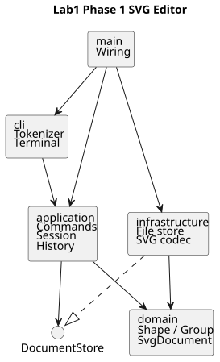

# 架构方案与开发记录

## 架构方案

### 模块划分

| 模块 | 职责 | 允许依赖 |
| --- | --- | --- |
| `src/domain/` | 有行为的图形类、容器树、画布、几何校验 | 仅本模块 |
| `src/application/` | 文档会话、Command、撤销重做、命令分发、输入校验 | domain、本层定义的端口 |
| `src/infrastructure/` | SVG XML 读写与文件系统适配 | application 的端口、domain、XML 库、Node 文件系统 |
| `src/cli/` | 分词、终端输入和输出 | application、Node 终端 API |
| `src/main.ts` | 装配对象及启动程序 | 上述模块 |
| `test/` | 验收与错误路径验证 | 被测模块、Node 测试 API |

组件图的 PlantUML 源文件为 [architecture.puml](architecture.puml)，渲染结果保存在本目录，无须外部图片服务即可查看。领域模型不得读取文件或打印输出；应用层通过端口访问存储，不能导入基础设施。唯一的装配点在 main。

### 设计模式的选择

- **Command（必需）**：每条 CLI 命令对应一个有行为的命令类；编辑命令经统一执行器执行，保存前后文档快照，支持 undo/redo。文档类命令成功后清空并锁定历史，直到下一次成功编辑。
- **Composite（必需语义）**：Group 与叶子共享 Shape 抽象；move/scale 通过多态执行，容器递归到子孙。统一 id 查找，容器删除整棵子树。
- **Memento**：快照是深拷贝的领域文档；编辑在克隆文档上进行，全部成功才替换会话，错误不留下部分修改。
- **Factory**：只有 ShapeFactory 允许从类型名选择具体图形类；XML 导入也复用此工厂。
- **依赖倒置**：文件读写通过 DocumentStore 端口注入，测试可以使用内存适配器。

按名字分派只保留两处：`CommandRegistry` 的命令名 → Command、`ShapeFactory` 的类型名 → 图形创建器。按作业要求，这两处在后续插件阶段列为待重构：将静态登记移至 provider 注册入口；本阶段不实现插件加载和 box。

### 变化点假设

| 变化点 | 本阶段处理 |
| --- | --- |
| 新增图形类型 | Shape 子类 + 唯一工厂登记点；不提前实现插件协议 |
| 新增命令 | 新 Command + 唯一命令登记点；复用事务与历史 |
| 更换输入方式（GUI/agent） | 领域与终端隔离；本阶段只交付 CLI |
| 更换存储或 XML 解析器 | DocumentStore 端口、单独 SvgCodec 适配 |
| 大文档撤销的性能 | 当前采用完整深拷贝，逻辑直接、可保证失败原子性；后续可换增量 Memento |

## 过程记录

1. 阅读作业后区分当前阶段和后续插件目标：本阶段仅 rect/circle/ellipse/line/text/g，create box 应报 unknown shape type。
2. 文档明确要求 Command 和面向对象，故不采用“公共数据对象 + switch(tag)”的实现。先提交架构，再按模型、命令、IO、验收真实推进。
3. 明确两项容易误读的语义：文档命令成功后 undo/redo 禁止；顶层 g 的 ungroup 依错误表拒绝，即使它是普通容器。
4. 过程仅记录实际完成的工作与实际发现的问题；后续实现和验证的结果将在相应提交补充。
5. 图形模型阶段通过 5 项测试，覆盖全部图形的递归几何变换、深拷贝隔离、分组顺序、循环拒绝及 id/属性约束。
6. 命令阶段通过累计 12 项测试。特别构造了大坐标 `1e308`：容器缩放时先前子图形可能已修改、后续子图形才溢出；通过副本文档事务验证整次操作回滚，且 redo 分支仍可使用。
7. 自查发现 CLI 分词器原本直接依赖 domain 的 EditorError，与设计的依赖方向不一致；改为标准 Error，由 LineProcessor 统一输出 error 前缀。
8. SVG 导入先扫描全部显式 id 再补缺失 id：避免先遇到的匿名 rect 被分配 rect1，随后才遇到文件里原有的 rect1。警告只在整份文件读入成功后返回。
9. IO 验收时发现 XML 库会保留未声明实体、丢弃非法零字符引用，且默认不解码合法数字字符引用。增加 XML 1.0 字符/实体校验，并配置数字引用解码；CDATA 和注释中的实体文本保持字面含义。相关回归测试已通过。
10. 发现导入的 `style="fill:red"` 会覆盖后续 set fill 设置的 presentation attribute；set 时清除 style 中同名声明，同时保留其他声明，增加回归测试。
11. 真实 CLI、文件原子保存及架构依赖检查合计 24 项测试全部通过。保存采用同目录临时文件 + rename；也验证了临时文件已写好但 rename 失败时会清理临时文件。
12. 在真实终端确认 svg> 提示符、逐行反馈及 Ctrl+D 退出；通过 npm run cli 运行作业 6.1 版本 A，生成含 8 个图形元素的 flowchart.svg。
13. Git 按“架构 → 图形模型 → 命令与历史 → SVG IO 与终端 → 文档验收”真实分步记录。没有把同一份完成品事后拆成虚假的开发历史。当前提交作者采用仓库局部的 SVG Editor Project 标识，不伪称这些修改由学生独立完成。
14. 最终对照原文发现，save 无参数明确指向 read 时的路径。初版显式另存会替换默认路径，与此不符；已改为另存不改已有默认路径，并增加 original.svg / copy.svg 的独立内容验证。
15. 修正保存语义后，严格编译和 25 项测试全部通过。架构图用 PlantUML 官方 JavaScript 引擎在本地渲染，检查过 SVG 的 XML 有效性及实际图片显示；流程图保存结果也已渲染检查。
16. 本人在 macOS 本地终端中完成了矩形创建、重复 id 检查、移动、撤销、重做、保存及读回测试，并在 Safari 中查看实际生成的 SVG。根据终端输出确认坐标依次为 50、30、50，读回后的属性保持一致；浏览器正确显示蓝色矩形。将这些实际验收结果补入质量保证记录，并随代码仓库提交。

## 一致性自查

### 模块划分

实际目录与方案一致。Shape、Rect、Circle、Ellipse、Line、Text、Group、SvgDocument 均有封装状态和领域行为；一个类对应一个同名文件。命令各有具体类，继承 EditCommand 的事务和历史协议，不在过程式函数中按 tag 分派操作。

### 依赖方向

`test/architecture.test.ts` 使用 TypeScript AST 检查全部生产源码：

- domain 只依赖 domain，无 Node 文件系统和外部 XML 库。
- application 只依赖 application/domain；DocumentStore 和 ShapeReaderFactory 是边界端口。
- infrastructure 只能以 type import 依赖应用端口，通过接口接受工厂和文档存储协议。
- cli 只依赖 cli/application 及 Node 终端 API。
- main 是跨模块对象装配的唯一入口。
- 每文件至多一个类，类名匹配文件名，无生产层自由函数声明。

检查已通过。设计中的两处名字分派都已在源码和本方案标注为后续插件阶段的待重构点；本阶段没有新增第三处图形类型或命令名分派入口。

## 质量保证手段

### 开发阶段自动测试

开发阶段由 AI 协作在 Node.js 24.15.0、TypeScript 5.9.3 环境执行 `npm test`，严格编译及 **25 项测试全部通过**。以下自动测试结果与本人随后进行的手动验收分别记录。

| 验证文件 | 核心验证内容 |
| --- | --- |
| `test/domain.test.ts` | 六类图形、递归几何、深拷贝、分组原顺序、循环拒绝、唯一 id 和几何约束 |
| `test/commands.test.ts` | 全部命令、引号/颜色/注释、容器变更、undo/redo、IO 后历史锁定、错误原子性与 redo 保留 |
| `test/svg.test.ts` | 作业外部文件、自动 id 避让、嵌套/文本/CDATA/XML 转义往返、变换、非法输入拒绝、样式覆盖、真实文件及失败清理 |
| `test/cli.test.ts` | 子进程实际运行程序、作业流程图保存读回、错误 stderr 单行输出及继续处理后续输入 |
| `test/architecture.test.ts` | AST 检查模块依赖、一类一文件、无生产自由函数声明 |

此外实际运行了 `npm run cli < examples/flowchart.cli`；交互终端中执行 init/create/move/undo/show 并检查恢复的位置。所有测试临时文件使用独立临时目录并清理。

### 本人本地手动验收

我在 macOS 本地终端中运行 `npm run cli`，创建 400×200 的画布，并用 `create rect r1 30 70 120 60 blue` 创建矩形。手动操作及实际结果如下：

| 验证内容 | 实际操作 | 实际结果 |
| --- | --- | --- |
| 创建图形 | `init 400 200`；`create rect r1 30 70 120 60 blue` | 成功创建画布和矩形 r1 |
| id 唯一性 | 再次执行同一条 create 命令 | 返回 `error: id already exists: r1`，后续操作可正常继续 |
| 移动 | `move r1 20 0`；`show r1` | x 从 30 变为 50，y 保持 70 |
| 撤销 | `undo`；`show r1` | x 恢复为 30 |
| 重做 | `redo`；`show r1` | x 再次变为 50 |
| 保存与读回 | `save my-test.svg`；`read my-test.svg`；`tree` | 读回后仍为 r1，x=50、y=70、width=120、height=60、fill=blue |
| 浏览器显示 | 用 Safari 打开生成的 `my-test.svg` | 正常显示蓝色矩形 |

这条手动验收流程验证了命令输入、图形编辑、撤销重做、文件保存与读回，以及生成文件的浏览器渲染。本次手动验收覆盖上述实际使用流程，更多命令和边界条件由开发阶段的自动测试覆盖。

### 实现口径与限制

- `ungroup` 拒绝顶层容器，遵从 4.2 节更具体的错误表。嵌套容器解散后，子节点占据原容器位置。
- 跨容器 group 挂在选中元素的最近公共父容器，孩子按原文档顺序排列；原文没有规定跨父级分组的新容器位置，因此选择这一确定性口径。
- g 的 set 通用样式写到 g 上，按 SVG 继承生效；不会覆盖子节点已有的显式样式。text 内容仅 text 元素可 set。
- init 省略尺寸时使用 800×600；仅给一个宽度时高度取 600。canvas 只给宽度时保留当前高度。
- 无参数 save 使用 read 建立的路径；显式另存不替换该路径。init 后首次保存须给路径，并以其建立默认保存路径；失败的 read/save 不改变路径。
- 不实现后续 box/插件。SVG 导入支持所列六类与数值/px、translate/正数等比 scale；path、tspan、defs、样式表等未列类型报错。复杂 CSS 及缺省字体/描边在变换下的完整视觉等价不作保证；不声称支持整个 SVG 标准。
- 快照实现按文档大小复制，优先保证错误原子性；大文档的内存和撤销性能尚未做压力优化。
- 原文没有截止日期，无法验证 final tag 是否早于课程截止时间。作业报告与代码一同提交到远程仓库，提交用的文档以 final 标签所指版本为准。
